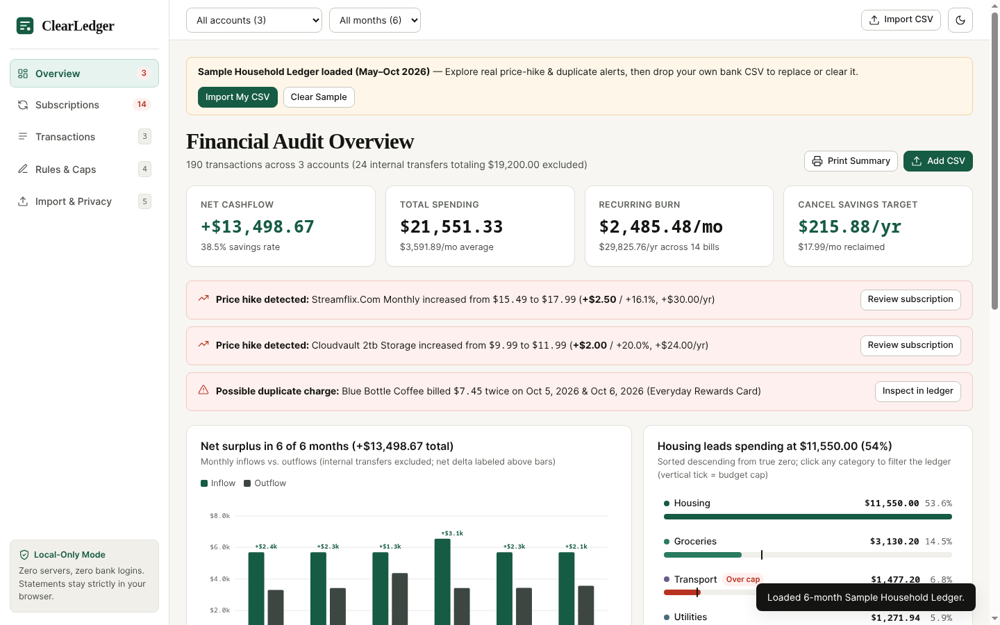

# ClearLedger

**Audit bank and credit card CSV statements privately in your browser — spot forgotten subscriptions, silent price hikes, duplicate charges, and spending leaks with zero bank logins and zero server uploads.**



---

## Why ClearLedger Exists

Personal finance apps increasingly charge steep recurring fees while requiring users to hand bank credentials to third-party data aggregators:

- **YNAB** costs **$14.99/month or $109/year** with no permanent free tier ([Plan & Multiply, Oct 2026](https://www.planandmultiply.com/en/blog/ynab-pricing-2026-plans-features-alternatives); [Stillware, Sep 2026](https://www.stillwareltd.com/blog/true-cost-of-ynab/)).
- **Monarch Money** costs **$14.99/month or $99.99/year** for Core (with Plus at $16.67/mo), offers no free tier, and relies on Plaid, Finicity, or MX ([Treasury, Nov 2026](https://treasury.sh/compare/rocket-money-vs-monarch); [Monarch Help, Nov 2026](https://help.monarch.com/hc/en-us/articles/360048393352-Guide-to-Connecting-Your-Accounts)).
- **Rocket Money** restricts web browser access and manual transactions to paid tiers (**$7–$15/month**) and requires bank linking via Plaid/Akoya on every tier ([Wally Review, Oct 2026](https://wallybudgeting.app/reviews/rocket-money); [Treasury, Nov 2026](https://treasury.sh/compare/rocket-money-vs-monarch)).

Meanwhile, consumers on [r/Frugal](https://www.reddit.com/r/Frugal/comments/1ihhkf9/budgeting_apps_that_do_not_require_personal_info/), [r/ynab](https://www.reddit.com/r/ynab/comments/1ph0su8/do_other_budget_apps_have_as_many_sync_issues_as/), and [r/Banking](https://www.reddit.com/r/Banking/comments/1qu0wta/which_tool_will_be_best_to_convert_bank_statement/) repeatedly ask for private, no-login tools that analyze exported CSV statements, track upcoming bills ([r/Frugal](https://www.reddit.com/r/Frugal/comments/1tswv2l/free_budgeting_app_that_shows_upcoming_bills/)), and surface recurring subscription creep without uploading financial records to external servers.

ClearLedger solves this directly in the browser with **$0 hosting overhead, zero external runtime dependencies, and zero network egress**.

---

## Intended Users

- Privacy-conscious households auditing checking and credit card statements without linking Plaid.
- Former Mint, YNAB, or Rocket Money users tired of paying $100+/year or fixing broken bank syncs.
- Freelancers and individuals doing monthly or quarterly subscription and cashflow reviews.

---

## Core Features

- **Multi-Bank CSV Auto-Mapping**: Detects headers and sign conventions for Chase, American Express, Capital One, Apple Card, Citi, YNAB/Mint exports, and generic CSV/TSV/semicolon files, with an interactive column-mapping preview before import.
- **Internal Transfer Deduplication**: Automatically flags credit-card autopays and internal transfers across combined checking + card statements so spending is never double-counted.
- **Recurring Charge & Silent Price-Hike Detector**: Classifies weekly, biweekly, monthly, quarterly, and annual cadences, filters out noisy variable retail merchants, flags silent subscription price increases with exact dollar/percent/annual impact, and projects upcoming 30-day bills.
- **Duplicate Charge Alerts**: Flags identical same-account merchant charges posted within 3 calendar days.
- **Interactive Subscription Triage**: Mark recurring charges as **Keep**, **Review**, or **Cancel** to compute exact annual savings in real time.
- **Perceptual-Grade SVG Charts**: True-zero-baseline monthly cashflow bars with direct net delta labels, clickable category spend bars with optional budget cap tick markers, and a 100% stacked subscription triage bar.
- **Custom Rules & Monthly Caps**: Create persistent merchant categorization rules and set monthly category spending limits.
- **Local-First PWA & Portability**: Persists locally in IndexedDB (with `localStorage` fallback), works offline via Service Worker, exports categorized CSV and JSON backups, supports print-ready audit summaries, and offers one-click local data erasure.
- **1-Click Sample Household Ledger**: Includes a clearly labeled 6-month, 3-account sample dataset so new users can inspect real price-hike and duplicate alerts before importing their own statements.

---

## Architecture & Technology Choices

ClearLedger uses **zero runtime dependencies**: native ES Modules (JavaScript), semantic HTML5, modern CSS3 custom properties, IndexedDB, and a Service Worker.

| Layer | Choice | Why Selected |
|---|---|---|
| Frontend | Native ES Modules + Semantic HTML5 | Sub-40 KB gzipped bundle, zero framework hydration cost, easy to audit for financial privacy. |
| Styling | Modular CSS3 Custom Properties (`tokens`, `base`, `layout`, `components`) | Light editorial paper & dark carbon themes with verified WCAG 2.2 AA/AAA contrast and clean print CSS. |
| Visualizations | Custom Inline SVG (`src/js/ui/charts.js`) | Crisp at any DPI, zero charting library bloat, strict true-zero baselines and direct labels. |
| Storage | IndexedDB (`clearledger_db_v1`) + `localStorage` fallback | Handles thousands of transactions locally without server databases or accounts. |
| Testing | Node 18 built-in `node:test` + Headless Chromium CDP verifier | Zero `node_modules` needed to run unit, integration, responsive, and visual tests. |
| Build | Custom Node script (`scripts/build.mjs`) | Concatenates & minifies CSS, syntax-checks every JS module via `node --check`, outputs `dist/`. |

See [ARCHITECTURE.md](./ARCHITECTURE.md) and [DESIGN.md](./DESIGN.md) for full technical and visual specifications.

---

## Performance, Security & Accessibility

- **Performance**: Production build (`dist/`) totals **132.9 KB raw / 39.1 KB gzipped** across HTML, minified CSS (`18.2 KB`), and 12 ES modules, with zero external font or CDN requests.
- **Security**: Strict Content Security Policy (`default-src 'self'; connect-src 'none'; script-src 'self'`), full `escapeHtml()` output encoding on every CSV-derived field, `X-Frame-Options: DENY`, `X-Content-Type-Options: nosniff`, and zero telemetry. See [SECURITY.md](./SECURITY.md).
- **Accessibility**: WCAG 2.2 AA/AAA contrast ratios in both light and dark modes, skip link, semantic landmarks (`header`, `nav`, `main`, `aside`), `:focus-visible` outlines, keyboard shortcuts (`1`–`5` view switching, `/` search focus, `Escape` dismiss), `aria-live="polite"` toast announcements, and `@media (prefers-reduced-motion: reduce)` support.

---

## Getting Started

### Prerequisites
- **Node.js 18+** (no `npm install` required — zero external dependencies).
- Optional: **Python 3.10+ & Chromium** to run the headless browser E2E/screenshot verifier.

### Development
```bash
npm run dev
# Opens local dev server at http://127.0.0.1:4173
```

### Testing
```bash
# Run unit & integration tests (Node 18 built-in test runner)
npm test

# Run headless Chromium E2E, responsive (375px/768px/1440px), and screenshot verification
npm run build
python3 tests/browser-verify.py
```

### Production Build & Preview
```bash
npm run build
npm run preview
# Serves minified dist/ at http://127.0.0.1:4174
```

---

## Deployment

ClearLedger is a static PWA (`dist/`) and requires **no backend, database, or environment variables** (`0` secrets).

- **Cloudflare Pages**: Connect your GitHub repository, set Build command to `npm run build`, and Build output directory to `dist`.
- **Netlify**: Ready out of the box via included [`netlify.toml`](./netlify.toml) (includes security headers and asset caching).
- **Vercel**: Ready out of the box via included [`vercel.json`](./vercel.json).
- **GitHub Pages**: Publish `dist/` via GitHub Actions or copy `dist/` to `gh-pages`.

*Note: ClearLedger is packaged as a deployment-ready repository; live public hosting has not been provisioned automatically.*

---

## Browser Compatibility

Tested on modern evergreen browsers supporting ES Modules, IndexedDB, CSS Custom Properties, and Service Workers:
- Google Chrome / Chromium 100+ (verified on Chromium 156)
- Microsoft Edge 100+
- Mozilla Firefox 100+
- Apple Safari 15.4+

---

## Known Limitations & Future Possibilities

- **CSV-only ingestion (v1.0)**: Native PDF bank statement OCR/table extraction is intentionally excluded in v1.0 to keep the bundle under 40 KB gzipped and avoid OCR inaccuracies; users export standard CSVs from their bank portal.
- **Single-device persistence**: Data lives in the local browser's IndexedDB; cross-device sync is manual via JSON backup export/import.
- **Future enhancements**: Optional WebCrypto AES-256-GCM encrypted backup files, Web Worker offloading for 50,000+ row multi-year ledgers, and OFX/QFX statement import support.

---

## License

MIT License — see [LICENSE](./LICENSE).
